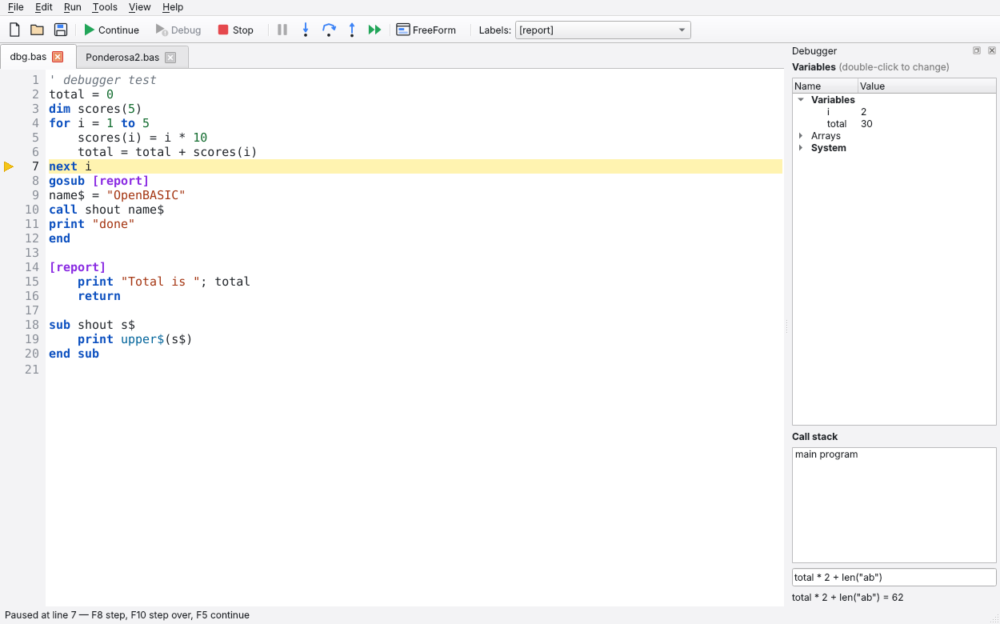
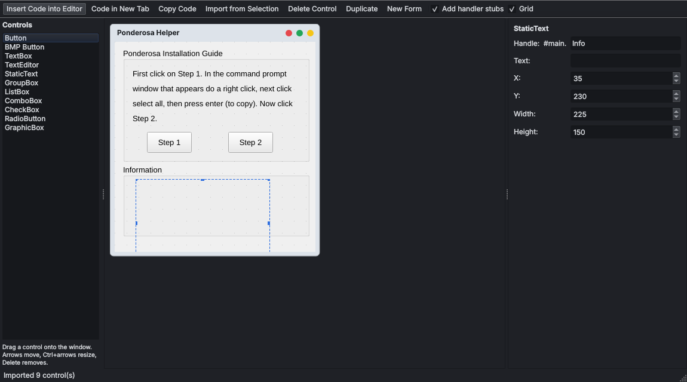
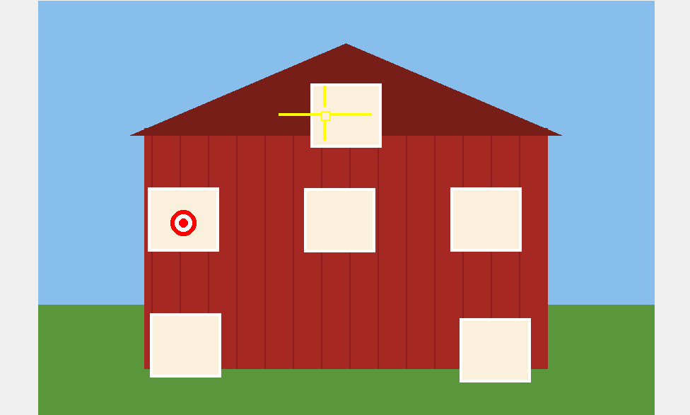

# OpenBASIC

An open source, cross-platform IDE that runs your **Just BASIC** and **Liberty BASIC** programs on
Windows, macOS and Linux — with the familiar edit → run workflow, a debugger, a FreeForm-style
GUI designer, and one-click standalone apps.



## Features

- **Runs real Just BASIC programs**: console (`mainwin`), windows and dialogs, buttons, textboxes,
  listboxes, comboboxes, checkboxes, radio buttons, menus, text windows, graphics windows,
  turtle graphics, bitmaps, **sprites** with Just BASIC's mask format, timers, `notice` / `confirm` /
  `prompt` / `filedialog`, sound, file I/O (sequential, random access and binary), `DATA`,
  `SUB`/`FUNCTION`, `GOSUB`, `SELECT CASE`, and more.
- **Windows programs work on Mac and Linux**: `bmp\button.bmp` paths, `C:\…` paths that no longer
  exist, upper/lower case file names, `run "notepad.exe file.txt"`, `run "cmd.exe /k …"` and common
  `CALLDLL` calls are all translated.
- **Debugger**: breakpoints (click a line number or press F9), step into / over / out, animate,
  pause, live variables and arrays, a call stack, change variables while paused, and evaluate
  expressions.
- **FreeForm GUI designer**: drag controls onto a window, edit their properties, and insert the
  generated code (with handler stubs) into your program. It can also import an existing window
  from your code so you can rearrange it.
- **Make Standalone App**: packages a program and the files it uses into an app that runs without
  OpenBASIC, the same way Just BASIC used a runtime plus a `.tkn` file.
- A modern editor: syntax highlighting, a branch-label jump list, find/replace, go to line,
  comment toggling, tabs, light and dark themes.

| FreeForm designer | Sprites (your Target game) |
|---|---|
|  |  |

## Getting started

### Ready-made apps

The **Build apps** GitHub Actions workflow produces OpenBASIC for Windows, macOS and Linux.
Push a tag such as `v1.0.0` and the zips are attached to a GitHub release (or run the workflow by
hand from the Actions tab and download them from the run).

### From source (any platform)

```bash
pip install -r requirements.txt   # PySide6, plus PyInstaller for standalone apps
python -m openbasic               # start the IDE
python -m openbasic myprog.bas    # open a program in the IDE
python -m openbasic --run myprog.bas   # run a program without the IDE
```

Or install it as a command: `pip install .` then run `openbasic`.

To build the desktop app yourself: `python build.py` (results in `dist/`).

## Using the IDE

| Key | Action |
|---|---|
| F5 | Run (or Continue when paused) |
| F7 | Debug — start paused on the first line |
| Shift+F5 | Stop |
| F9 | Toggle breakpoint (or click a line number) |
| F8 / F10 / Shift+F11 | Step into / over / out |
| Ctrl+F8 | Animate (run slowly, highlighting each line) |
| Ctrl+F7 | Check syntax without running |
| Ctrl+Shift+D | FreeForm GUI designer |
| Ctrl+F, Ctrl+G, Ctrl+/ | Find/replace, go to line, toggle comment |

**Run** with breakpoints set starts the debugger automatically. While paused, double-click a
variable to change it, or type an expression in the box under the call stack.

**FreeForm**: drag controls from the list onto the window. Arrow keys move the selected
control, Ctrl+arrows resize it, Delete removes it. *Insert Code into Editor* puts the code at the
cursor; handler stubs are skipped for labels that already exist. Select window code in the
editor before opening FreeForm (or use *Import from Selection*) to edit an existing window.

**Make Standalone App** (Tools menu) creates a folder with `YourProgram` (`.exe` on Windows,
`.app` on macOS), `YourProgram.obp` and the files your program mentions (bitmaps, sounds, data
files). Copy the whole folder to share it. Apps are built for the system you're on. The first
build when running from source prepares a runtime with PyInstaller, which takes a few minutes
once. The ready-made IDE apps use themselves as the runtime, so builds are instant.

## Compatibility notes

OpenBASIC follows Just BASIC 1.0/2.0 and many Liberty BASIC 4 additions. A few long-standing
quirks are fixed on purpose:

- `not(1 = 1)` is false (Just BASIC's bitwise NOT made it true).
- `RETURN` reached without a `GOSUB` waits for events instead of stopping with an error.
- Reaching the end of the program with windows open keeps handling their events.
- The `mainwin` console only appears when the program prints or asks for input.
- System variables (`WindowWidth`, `DisplayHeight`, …) aren't case sensitive.
- Windows open centered unless `UpperLeftX`/`UpperLeftY` are set.
- Reading past the end of a file returns an empty string instead of stopping.
- Errors name the line and say what went wrong in plain words.

**Windows-only features on Mac and Linux.** `RUN` translates `cmd.exe` (opens a terminal),
`notepad.exe` (default text editor), `explorer.exe` (default file browser or web browser),
`calc.exe` and `mspaint.exe`; anything else runs as a shell command. `CALLDLL` emulates
`MessageBoxA`, `Sleep`, `GetTickCount`, `Beep`, `sndPlaySoundA`/`PlaySoundA`,
`GetSystemMetrics`, `GetAsyncKeyState`/`GetKeyState` and `ShellExecuteA` everywhere; on Windows,
other calls go to the real DLL. Windows font names map to similar fonts on each system.

**Not supported yet:** `STRUCT`, `CALLBACK`, printing to a printer (`LPRINT` prints to the
console), and `.tkn` files (use the `.bas` source).

## Project layout

```
openbasic/
  lexer.py, parser.py      reading BASIC source
  interp.py, builtins.py   compiler + interpreter, built-in functions
  fileio.py, paths.py      files, and Windows-path translation
  platform_run.py          RUN statement on each platform
  dllemu.py                CALLDLL emulation
  runtime/                 Qt windows, controls, graphics, sprites, dialogs, sound
  ide/                     editor, debugger UI, FreeForm designer, packager
  examples/                sample programs (File > Open Example)
tests/                     language tests and GUI tests (your programs are in tests/samples)
```

Run the tests with `QT_QPA_PLATFORM=offscreen python -m pytest`.

## License

MIT — see [LICENSE](LICENSE).

Just BASIC and Liberty BASIC are products of Shoptalk Systems. OpenBASIC is an independent,
compatible implementation and is not affiliated with or endorsed by Shoptalk Systems.
